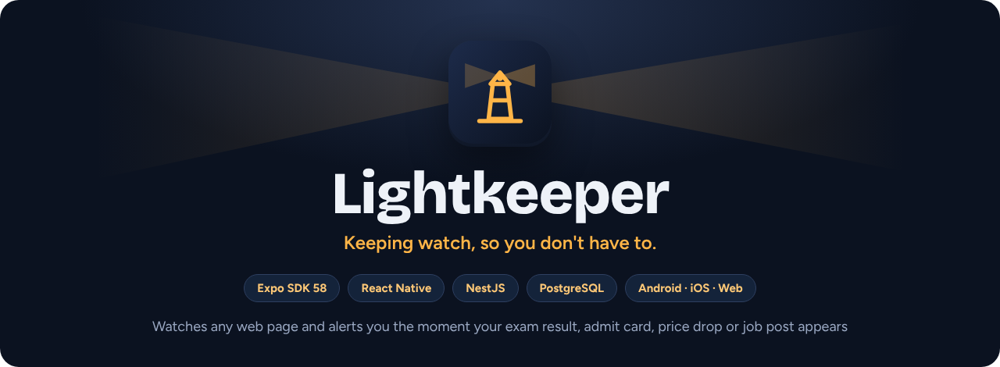
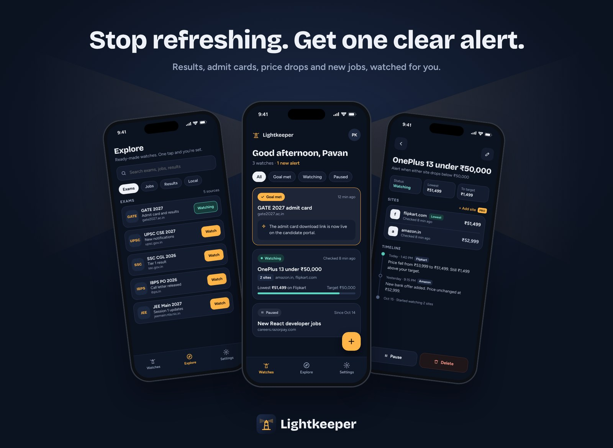
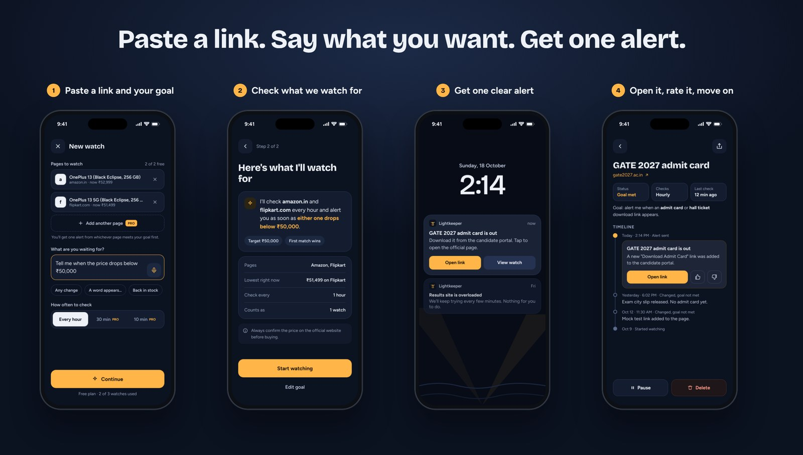
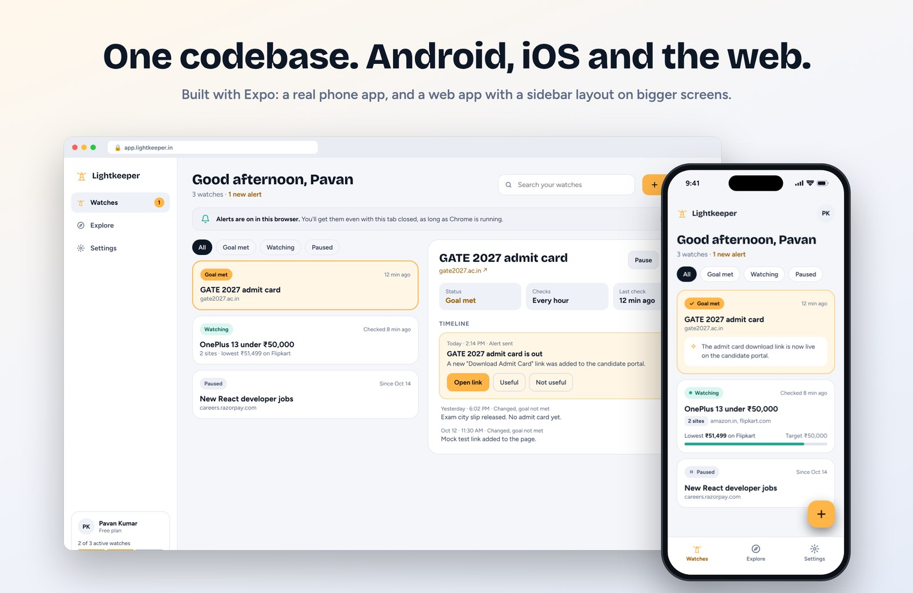
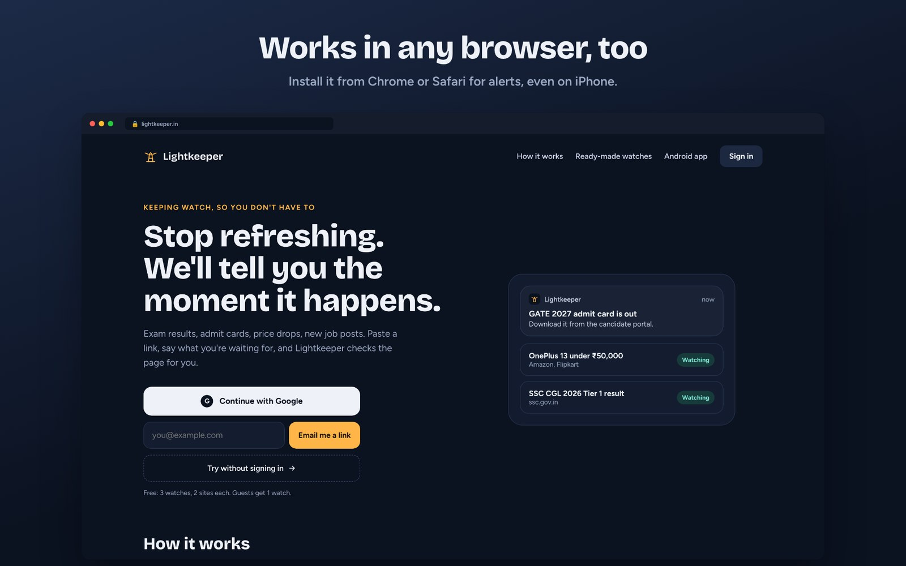
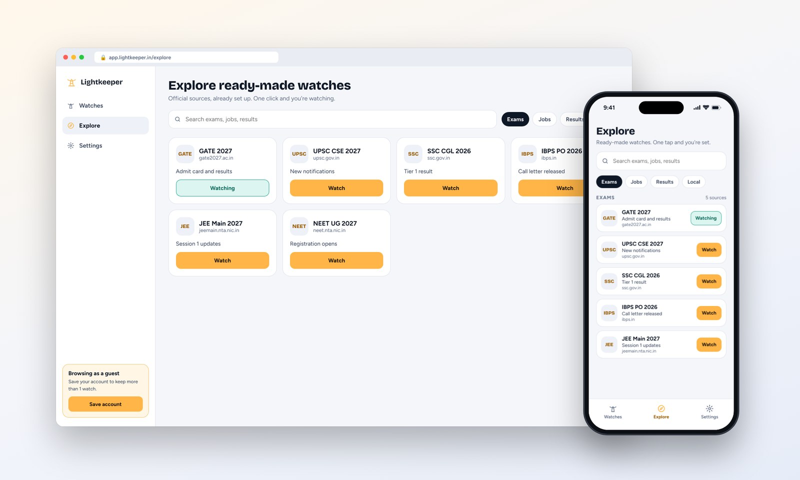
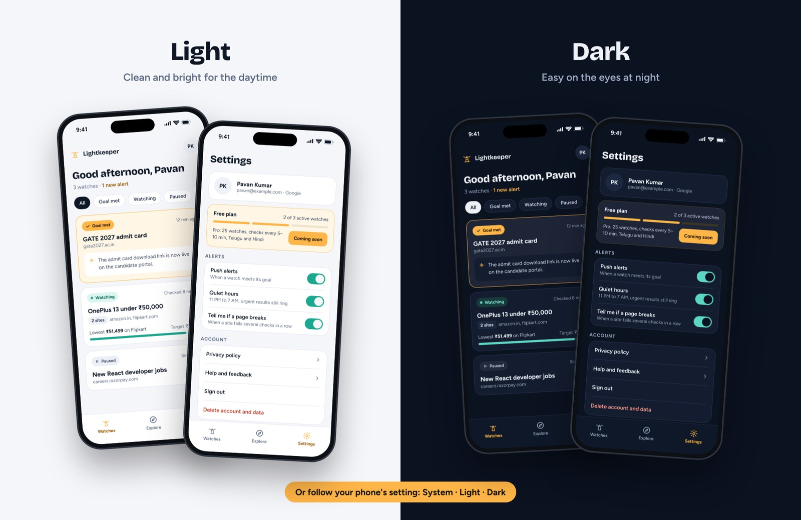

<p align="center">
  
</p>

<p align="center">
  <b>Stop refreshing result sites. Lightkeeper watches any web page and sends one clear alert the moment the thing you're waiting for appears.</b>
</p>

<p align="center">
  
  
  
  
  
  
</p>



## Why Lightkeeper

Millions of students refresh exam sites waiting for an admit card or a result. Shoppers check prices every day. Job seekers reload careers pages. Most of them still miss the moment, or join noisy Telegram channels to hear about it.

Lightkeeper does the refreshing for you:

- **Say it in plain words.** "Tell me when the GATE 2027 admit card is out." "Alert me when this phone drops below ₹50,000."
- **One goal, up to two sites free.** Watch Amazon *and* Flipkart; the first one to hit your price wins.
- **Only speaks up when it matters.** It alerts on *new* mentions, not on words that were already on the page, and never on every tiny change.
- **Ready-made watches** for Indian exams, results and careers pages: one tap and you're watching.
- **Try it without an account.** Guest mode gives you a watch straight away; save your account later and keep it.

## How it works



1. **Paste a link and say what you're waiting for.** Add a second site if you like.
2. **Check what we'll watch for.** Lightkeeper rewrites your goal into a precise check: words to look for, a price target, or any change.
3. **Forget about it.** The server checks the page on schedule. Same page as last time? Nothing happens.
4. **Get one clear alert** with a one-line summary and the direct link, then rate it *Useful* or *Not useful*.

## One codebase: Android, iOS and the web



The app is built once with **Expo** and runs as:

| Platform | How it's delivered | Alerts |
| --- | --- | --- |
| **Android** | Installable app (APK now, Play Store later) | Push notifications |
| **iOS** | Same code, via TestFlight / App Store later | Push notifications |
| **Web** | Responsive web app: sidebar and split view on laptops, bottom tabs on phones | Web Push; on iPhone after *Add to Home Screen* |





## Light, dark, or follow the system



Settings → Appearance offers **System**, **Light** and **Dark**. The choice is saved on the device, and the web app has the same switch in its sidebar.

## Tech stack

| Layer | Choice |
| --- | --- |
| App (Android, iOS, web) | Expo SDK 58, React Native, Expo Router, TypeScript |
| Backend | NestJS 11, Prisma, PostgreSQL |
| Page checking | Node fetch + Cheerio text extraction, SHA-256 change detection, keyword / price / any-change rules |
| Planned | Firebase Auth (Google, email link, anonymous guest), Firebase Cloud Messaging, Gemini for goal parsing and summaries |
| Hosting (planned) | Web on Netlify; API on Render + Neon, moving to an Oracle Cloud free VM |

```
lightkeeper/
├── apps/
│   ├── mobile/          # Expo app: screens in app/, UI kit in src/components, theme in src/theme
│   └── api/             # NestJS API + checker, Prisma schema in prisma/schema.prisma
└── docs/images/         # README images
```

## Run it locally

You need **Node.js 22.13+** (Node 24 LTS recommended), **Git** and **Docker Desktop**.

**1. Backend**

```bash
cd apps/api
copy .env.example .env      # macOS/Linux: cp .env.example .env
npm install
npm run db:up               # PostgreSQL in Docker
npm run db:push             # create the tables
npm run dev                 # http://localhost:3000, checker runs every minute
```

Check http://localhost:3000/health shows `"database": "ok"`.

**2. App** (second terminal)

```bash
cd apps/mobile
npm install
npm run web                 # in the browser
npm run android             # Android emulator (start one in Android Studio first)
```

On a real phone, copy `apps/mobile/.env.example` to `.env` and set `EXPO_PUBLIC_API_URL=http://<your-laptop-ip>:3000`. The phone and laptop must be on the same Wi-Fi.

**3. Trigger a real alert in two minutes**

The API ships a fake results page you control:

1. In the app: **New watch** → `http://localhost:3000/dev/test-page` → *Tell me when the result is out*.
2. Open http://localhost:3000/dev/control → **Publish result**.
3. Open the watch → **Check now**. It turns **Goal met**, with an alert linking straight to the result.

The control page can also drop the price (try *below ₹50,000*) or add a notice (try *when this page changes*).

## How checking works

1. Every minute the checker finds pages whose watches are due (hourly on the free plan).
2. It downloads the page, drops scripts and styles, and keeps the visible text, one line per block.
3. Same text as last time → done, no further work.
4. Otherwise each watch on that page is judged:
   - **Words**: alert when a *new* line mentions them (with qualifiers like "2026" or "Tier 1" when given).
   - **Price**: alert when the first ₹ price on the page is at or below the target.
   - **Any change**: alert when the visible text changes.
5. A met goal marks the watch **Goal met** and records the alert. Sites failing 3 checks in a row are flagged on the timeline; checks continue.

A page watched by many people is fetched once. Private network addresses are blocked unless `ALLOW_PRIVATE_URLS=true` (development).

## Plans

| | Guest | Free | Pro (coming soon) |
| --- | --- | --- | --- |
| Active watches | 1 | 3 | 25 |
| Sites per watch | 2 | 2 | 10 |
| Check frequency | Hourly | Hourly | Every 5–10 minutes |

Paused watches don't count toward the limit.

---

<p align="center">Built by <a href="https://github.com/PaVaN1063">Pavan Kumar Naraharisetti</a></p>
